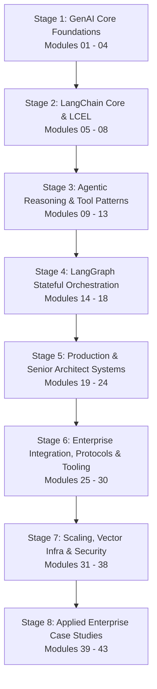

# 🧠 Senior GenAI & Agentic AI Master Curriculum (Chronological Track)

This repository contains the definitive hands-on, runnable curriculum for mastering **Generative AI, LangChain, LangGraph, and Enterprise Agentic Architectures** as expected of a **Senior GenAI Engineer (3+ Years Experience, L5/Senior IC level)** in top-tier product-based companies (Google, OpenAI, Meta, Uber, Stripe, Microsoft).

All **43 modules** are written in **standard Python (3.9+) with zero required external pip dependencies**. They run immediately offline with intelligent simulation traces, while seamlessly supporting live models (OpenAI, Ollama, Groq, DeepSeek, or any OpenAI-compatible gateway) via a `.env` file.

---

## 🗺️ Chronological Learning Path

The 8 stages build strictly on each other — each module only imports from
one already covered earlier in the sequence (via `importlib.import_module`,
since filenames start with digits), so reading in order never spoils a
later "from scratch" implementation with a forward reference. Modules
33-34 (ANN indexing, vector DB clients) revisit module 02's vector math and
module 19's hybrid retrieval with production infra — read them back-to-back
with those if you prefer topic-grouped study over strict numeric order.
Stage 8 is the deliberate capstone: it doesn't teach new primitives, it
composes RAG (39) + Text-to-SQL (40) + eval (41) + optimization (42) into
one agentic system (43), so it's meant to be read last, once everything it
imports is already familiar.



---

### 🟢 Stage 1: GenAI & LLM Core Foundations (Modules 01 – 04)

* [**`01_genai_foundations_sampling_and_tokens.py`**](file:///Users/aseemnarwal/Documents/Devlopment%20/Studing%20/Agentic%20AI/01_genai_foundations_sampling_and_tokens.py):
  * **Concepts**: Byte-Pair Encoding (BPE), subwords vs characters, token arithmetic; Softmax temperature logit scaling ($z_i / T$); Top-P (nucleus sampling), Top-K, Frequency & Presence penalties; Prompt engineering paradigms (Zero-shot, Few-shot ICL, Zero-shot CoT).
* [**`02_embeddings_and_vector_math.py`**](file:///Users/aseemnarwal/Documents/Devlopment%20/Studing%20/Agentic%20AI/02_embeddings_and_vector_math.py):
  * **Concepts**: Vector space math; Cosine Similarity, Dot Product, Euclidean Distance (L2), Manhattan (L1); Mathematical proof of why unit normalization equates Dot Product to Cosine Similarity; Exact k-Nearest Neighbors (k-NN) search.
* [**`03_chunking_and_document_loaders.py`**](file:///Users/aseemnarwal/Documents/Devlopment%20/Studing%20/Agentic%20AI/03_chunking_and_document_loaders.py):
  * **Concepts**: Document ingestion; Recursive Character Text Splitting (hierarchical separators `["\n\n", "\n", " ", ""]`); Markdown header-aware metadata splitting; Chunk size vs chunk overlap trade-offs.
* [**`04_unified_llm_client.py`**](file:///Users/aseemnarwal/Documents/Devlopment%20/Studing%20/Agentic%20AI/04_unified_llm_client.py):
  * **Concepts**: Unified LLM client supporting offline simulation and live OpenAI/Ollama HTTP integration via `urllib.request`.

---

### 🟡 Stage 2: LangChain Core & LCEL Architecture (Modules 05 – 08)

* [**`05_langchain_lcel_runnables_and_pipes.py`**](file:///Users/aseemnarwal/Documents/Devlopment%20/Studing%20/Agentic%20AI/05_langchain_lcel_runnables_and_pipes.py):
  * **Concepts**: LangChain Expression Language (LCEL) architecture; The `Runnable` protocol (`invoke`, `batch`, `__or__`, `__ror__`); Declarative pipe syntax (`prompt | model | parser`); `RunnablePassthrough`, `RunnableParallel`, and `RunnableLambda`.
* [**`06_langchain_output_parsers_and_schemas.py`**](file:///Users/aseemnarwal/Documents/Devlopment%20/Studing%20/Agentic%20AI/06_langchain_output_parsers_and_schemas.py):
  * **Concepts**: Output parsers (`CommaSeparatedListOutputParser`, `JsonOutputParser`); Extracting structured JSON from markdown code fences; Injecting format instructions (`get_format_instructions()`).
* [**`07_langchain_retrievers_and_chains.py`**](file:///Users/aseemnarwal/Documents/Devlopment%20/Studing%20/Agentic%20AI/07_langchain_retrievers_and_chains.py):
  * **Concepts**: LangChain Retrievers; Modern LCEL RAG composition `{"context": retriever | format_docs, "question": RunnablePassthrough()} | prompt | model | parser`; `MultiQueryRetriever` (expanding user query to boost document recall).
* [**`08_langchain_callbacks_and_streaming.py`**](file:///Users/aseemnarwal/Documents/Devlopment%20/Studing%20/Agentic%20AI/08_langchain_callbacks_and_streaming.py):
  * **Concepts**: `BaseCallbackHandler` lifecycle hooks (`on_chain_start`, `on_llm_new_token`, `on_chain_end`); Decoupled real-time token streaming and latency/cost telemetry.

---

### 🟠 Stage 3: Agentic Reasoning & Tool Patterns (Modules 09 – 13)

* [**`09_react_agent_reasoning_and_acting.py`**](file:///Users/aseemnarwal/Documents/Devlopment%20/Studing%20/Agentic%20AI/09_react_agent_reasoning_and_acting.py):
  * **Concepts**: Classic ReAct loop (Thought $\rightarrow$ Action $\rightarrow$ Observation); Scratchpad accumulation; Loop limits to prevent infinite cycles.
* [**`10_native_tool_calling_and_schemas.py`**](file:///Users/aseemnarwal/Documents/Devlopment%20/Studing%20/Agentic%20AI/10_native_tool_calling_and_schemas.py):
  * **Concepts**: Native tool calling with automatic JSON Schema generation from Python functions & type annotations; Schema validation and parallel tool execution.
* [**`11_agent_memory_systems.py`**](file:///Users/aseemnarwal/Documents/Devlopment%20/Studing%20/Agentic%20AI/11_agent_memory_systems.py):
  * **Concepts**: 4-tier memory systems (Short-term Working memory, Episodic memory for user preferences, Semantic memory for factual RAG, and Procedural SOPs).
* [**`12_planning_and_dynamic_replanning.py`**](file:///Users/aseemnarwal/Documents/Devlopment%20/Studing%20/Agentic%20AI/12_planning_and_dynamic_replanning.py):
  * **Concepts**: Plan-and-Solve task decomposition; Runtime failure detection and in-flight dynamic replanning without restarting from scratch.
* [**`13_reflection_and_self_correction.py`**](file:///Users/aseemnarwal/Documents/Devlopment%20/Studing%20/Agentic%20AI/13_reflection_and_self_correction.py):
  * **Concepts**: Reflexion loop (Actor generates $\rightarrow$ Automated test harness evaluates $\rightarrow$ Verbal self-reflection buffer $\rightarrow$ Code self-repair until 100% pass).

---

### 🔵 Stage 4: LangGraph Stateful Orchestration (Modules 14 – 18)

* [**`14_langgraph_core_stategraph_and_reducers.py`**](file:///Users/aseemnarwal/Documents/Devlopment%20/Studing%20/Agentic%20AI/14_langgraph_core_stategraph_and_reducers.py):
  * **Concepts**: LangGraph core: `StateGraph`, `START`, and `END`; Reducer semantics (`add_messages` appending state deltas rather than overwriting); Nodes, direct edges, and conditional routing edges.
* [**`15_langgraph_human_in_the_loop_and_checkpoints.py`**](file:///Users/aseemnarwal/Documents/Devlopment%20/Studing%20/Agentic%20AI/15_langgraph_human_in_the_loop_and_checkpoints.py):
  * **Concepts**: LangGraph `MemorySaver` checkpointer; Breakpoints (`interrupt_before=["deploy_node"]`); Inspecting state, mutating state via `update_state()`, and resuming execution with `invoke(None)`.
* [**`16_langgraph_subgraphs_and_hierarchical_teams.py`**](file:///Users/aseemnarwal/Documents/Devlopment%20/Studing%20/Agentic%20AI/16_langgraph_subgraphs_and_hierarchical_teams.py):
  * **Concepts**: Subgraph encapsulation (registering a compiled graph as a node inside a parent graph); Hierarchical delegation (Supervisor routes to Research Team and Coding Team subgraphs).
* [**`17_langgraph_map_reduce_and_send.py`**](file:///Users/aseemnarwal/Documents/Devlopment%20/Studing%20/Agentic%20AI/17_langgraph_map_reduce_and_send.py):
  * **Concepts**: The LangGraph `Send` primitive; Dynamic Map-Reduce (spawning $N$ parallel workers dynamically and reducing with an aggregator node).
* [**`18_multi_agent_collaboration_and_debate.py`**](file:///Users/aseemnarwal/Documents/Devlopment%20/Studing%20/Agentic%20AI/18_multi_agent_collaboration_and_debate.py):
  * **Concepts**: Multi-persona peer debate (Product Manager, Security Architect, Principal Engineer) resolving trade-offs into an Architecture Decision Record (ADR).

---

### 🔴 Stage 5: Production & Senior Architect Systems (Modules 19 – 24)

* [**`19_advanced_rag_hybrid_and_reranking.py`**](file:///Users/aseemnarwal/Documents/Devlopment%20/Studing%20/Agentic%20AI/19_advanced_rag_hybrid_and_reranking.py):
  * **Concepts**: Production RAG; Okapi BM25 sparse search + Dense semantic search; Reciprocal Rank Fusion (RRF); Cross-encoder reranking; Lost-in-the-Middle context reordering.
* [**`20_agent_observability_and_opentelemetry.py`**](file:///Users/aseemnarwal/Documents/Devlopment%20/Studing%20/Agentic%20AI/20_agent_observability_and_opentelemetry.py):
  * **Concepts**: OpenTelemetry (OTel) distributed tracing; Hierarchical spans; Precise token usage and USD cost accounting; OpenInference export format.
* [**`21_production_guardrails_and_safety.py`**](file:///Users/aseemnarwal/Documents/Devlopment%20/Studing%20/Agentic%20AI/21_production_guardrails_and_safety.py):
  * **Concepts**: Reversible PII token vault (masking before LLM egress and restoring on return); Indirect Prompt Injection detection inside tool payloads.
* [**`22_agent_evals_and_llm_as_a_judge.py`**](file:///Users/aseemnarwal/Documents/Devlopment%20/Studing%20/Agentic%20AI/22_agent_evals_and_llm_as_a_judge.py):
  * **Concepts**: CI/CD Agent Evals; Trajectory accuracy; Step Efficiency Ratio (penalizing wandering agents); LLM-as-a-Judge multi-dimensional scoring rubrics.
* [**`23_tree_of_thoughts_and_beam_search.py`**](file:///Users/aseemnarwal/Documents/Devlopment%20/Studing%20/Agentic%20AI/23_tree_of_thoughts_and_beam_search.py):
  * **Concepts**: Combinatorial planning; Branch generation; Heuristic state evaluation / value function; Beam Search pruning; Backtracking to escape dead-ends.
* [**`24_production_capstone_sre_agent.py`**](file:///Users/aseemnarwal/Documents/Devlopment%20/Studing%20/Agentic%20AI/24_production_capstone_sre_agent.py):
  * **Concepts**: End-to-end Enterprise SRE Incident Remediation Service integrating Hybrid RAG, OTel tracing, PII masking, HITL approval, async tool execution, and idempotency.

---

### 🟣 Stage 6: Enterprise Integration, Protocols & Tooling (Modules 25 – 30)

* [**`25_fastapi_service_layer_and_dependency_injection.py`**](file:///Users/aseemnarwal/Documents/Devlopment%20/Studing%20/Agentic%20AI/25_fastapi_service_layer_and_dependency_injection.py):
  * **Concepts**: Serving agents over HTTP; FastAPI-style declarative routing with path params; Pydantic-style request validation; `Depends`-based Dependency Injection; automatic OpenAPI schema generation.
* [**`26_grpc_and_protocol_buffers.py`**](file:///Users/aseemnarwal/Documents/Devlopment%20/Studing%20/Agentic%20AI/26_grpc_and_protocol_buffers.py):
  * **Concepts**: Protocol Buffers wire format from first principles (varint encoding, tag/wire-type framing); the 4 gRPC call shapes — Unary, Server-streaming, Client-streaming, Bidirectional-streaming.
* [**`27_redis_caching_and_agent_state.py`**](file:///Users/aseemnarwal/Documents/Devlopment%20/Studing%20/Agentic%20AI/27_redis_caching_and_agent_state.py):
  * **Concepts**: Cache-aside pattern for LLM responses (prompt hashing + TTL); Redis-backed agent session/working-memory shared across stateless service replicas; rate-limit counters via `INCR`.
* [**`28_postman_and_api_contract_testing.py`**](file:///Users/aseemnarwal/Documents/Devlopment%20/Studing%20/Agentic%20AI/28_postman_and_api_contract_testing.py):
  * **Concepts**: Auto-generating a Postman Collection (v2.1 schema) directly from live API routes; a Newman-style collection runner that asserts status codes/response shape as a CI contract-testing gate.
* [**`29_mcp_model_context_protocol.py`**](file:///Users/aseemnarwal/Documents/Devlopment%20/Studing%20/Agentic%20AI/29_mcp_model_context_protocol.py):
  * **Concepts**: Model Context Protocol (Host/Client/Server architecture); JSON-RPC 2.0 message envelope; `initialize` capability negotiation, `tools/list`, `tools/call`, `resources/list`.
* [**`30_a2a_agent_to_agent_protocol.py`**](file:///Users/aseemnarwal/Documents/Devlopment%20/Studing%20/Agentic%20AI/30_a2a_agent_to_agent_protocol.py):
  * **Concepts**: Agent2Agent (A2A) protocol; Agent Card capability discovery; formal Task lifecycle (`submitted` → `working` → `input-required` → `completed`/`failed`); typed Message Parts (`TextPart`, `DataPart`); cross-vendor agent delegation via `tasks/send`/`tasks/get`.

---

### ⚪ Stage 7: Scaling, Vector Infra & Security (Modules 31 – 38)

* [**`31_semantic_and_prompt_caching.py`**](file:///Users/aseemnarwal/Documents/Devlopment%20/Studing%20/Agentic%20AI/31_semantic_and_prompt_caching.py):
  * **Concepts**: Semantic caching via embedding-similarity lookup (catches paraphrases exact-hash caching misses); Anthropic-style prompt/KV-cache cost modeling (cache write premium vs. cache read discount).
* [**`32_model_routing_and_cost_cascading.py`**](file:///Users/aseemnarwal/Documents/Devlopment%20/Studing%20/Agentic%20AI/32_model_routing_and_cost_cascading.py):
  * **Concepts**: Weighted round robin across backends; failover routing on provider outage; cost cascading (cheap model first, escalate to an expensive model only on a low-confidence answer) — the mechanics behind gateways like OpenRouter/OmniRoute.
* [**`33_ann_indexing_hnsw_and_ivf.py`**](file:///Users/aseemnarwal/Documents/Devlopment%20/Studing%20/Agentic%20AI/33_ann_indexing_hnsw_and_ivf.py):
  * **Concepts**: Approximate Nearest Neighbor search; IVF (k-means coarse quantization + inverted lists); HNSW (navigable small-world proximity graph + bounded greedy search); recall@k vs. distance-computation tradeoffs against exact k-NN.
* [**`34_vector_database_client_patterns.py`**](file:///Users/aseemnarwal/Documents/Devlopment%20/Studing%20/Agentic%20AI/34_vector_database_client_patterns.py):
  * **Concepts**: Pinecone/Qdrant-style client API (`upsert`, `query`, `delete`, `fetch`); metadata pre-filtering combined with vector search; multi-tenant namespace isolation.
* [**`35_api_auth_oauth2_and_jwt.py`**](file:///Users/aseemnarwal/Documents/Devlopment%20/Studing%20/Agentic%20AI/35_api_auth_oauth2_and_jwt.py):
  * **Concepts**: JWT construction/verification from scratch (HMAC-SHA256, expiry, constant-time signature comparison); OAuth2 client-credentials grant; scope-based access control wired into module 25's FastAPI service via nested `Depends`.
* [**`36_sandboxed_execution_and_least_privilege.py`**](file:///Users/aseemnarwal/Documents/Devlopment%20/Studing%20/Agentic%20AI/36_sandboxed_execution_and_least_privilege.py):
  * **Concepts**: Static AST vetting of LLM-generated code (rejecting imports, dynamic eval/exec, dunder-attribute sandbox escapes); process-isolated execution with a hard timeout; least-privilege tool scoping per agent role with an audit log.
* [**`37_llm_app_ci_testing_and_golden_datasets.py`**](file:///Users/aseemnarwal/Documents/Devlopment%20/Studing%20/Agentic%20AI/37_llm_app_ci_testing_and_golden_datasets.py):
  * **Concepts**: Mocking an LLM client for deterministic, free unit tests; golden-dataset regression testing via predicates (not exact-match assertions); snapshot diffing to catch prompt drift.
* [**`38_async_job_queues_for_agent_pipelines.py`**](file:///Users/aseemnarwal/Documents/Devlopment%20/Studing%20/Agentic%20AI/38_async_job_queues_for_agent_pipelines.py):
  * **Concepts**: Decoupled producer/consumer agent pipelines; at-least-once delivery via ack/nack; retry-with-cap + Dead Letter Queue; a concurrent async worker pool processing real LLM calls.

---

### 🟤 Stage 8: Applied Enterprise Case Studies (Modules 39 – 43)

A capstone arc reusing nearly every prior module end to end — the same four
system designs behind real healthcare/pharma analytics platforms (multimodal
document RAG, Text-to-SQL over a data warehouse, promotional-sequence
optimization, and a stateful multi-tool agent), built as genuinely working
pipelines rather than architecture diagrams.

* [**`39_multimodal_document_rag_pipeline.py`**](file:///Users/aseemnarwal/Documents/Devlopment%20/Studing%20/Agentic%20AI/39_multimodal_document_rag_pipeline.py):
  * **Concepts**: Document Intelligence (OCR/layout/table extraction stand-in); hierarchical chunking (Document → Section → Subsection → Chunk); metadata enrichment + role-based access filtering; hybrid retrieval + RRF + rerank (reusing module 19); grounded answers with verified citations (reusing module 21).
* [**`40_text_to_sql_enterprise_analytics.py`**](file:///Users/aseemnarwal/Documents/Devlopment%20/Studing%20/Agentic%20AI/40_text_to_sql_enterprise_analytics.py):
  * **Concepts**: Schema retrieval (sending only relevant tables to the LLM); prompt construction with business rules + few-shot examples; multi-stage SQL validation (syntax via SQLite's own parser, safety, schema-slice scoping); **real** execution against a stdlib SQLite database; NL result summarization.
* [**`41_rag_evaluation_ragas_style_metrics.py`**](file:///Users/aseemnarwal/Documents/Devlopment%20/Studing%20/Agentic%20AI/41_rag_evaluation_ragas_style_metrics.py):
  * **Concepts**: RAGAS's four core metrics from scratch — Faithfulness (claim decomposition + per-claim grounding), Answer Relevancy (reverse-engineered questions + embedding similarity), Context Precision (rank-weighted relevance, i.e. Average Precision), Context Recall (ground-truth fact attribution).
* [**`42_temporal_forecasting_and_genetic_optimization.py`**](file:///Users/aseemnarwal/Documents/Devlopment%20/Studing%20/Agentic%20AI/42_temporal_forecasting_and_genetic_optimization.py):
  * **Concepts**: An LSTM cell with real forget/input/candidate/output gates, trained via genuine gradient descent (numerical gradients) on synthetic HCP response sequences; a Genetic Algorithm (selection, crossover, mutation, elitism) using the trained LSTM as its fitness function to evolve a constraint-respecting 13-week promotional sequence.
* [**`43_enterprise_multi_tool_agentic_router.py`**](file:///Users/aseemnarwal/Documents/Devlopment%20/Studing%20/Agentic%20AI/43_enterprise_multi_tool_agentic_router.py):
  * **Concepts**: The capstone — module 14's real `StateGraph` engine routing each query to RAG (39), Text-to-SQL (40), or an external API tool, with an evaluation node deciding to loop back or return a final grounded response — the full Agent → Route → Tool → Observe → Evaluate → Continue? loop.

---

## 🚀 How to Run and Experiment

You can execute any module directly in your terminal:

```bash
# Stage 1: GenAI Core
python3 01_genai_foundations_sampling_and_tokens.py
python3 02_embeddings_and_vector_math.py
python3 03_chunking_and_document_loaders.py
python3 04_unified_llm_client.py

# Stage 2: LangChain Core & LCEL
python3 05_langchain_lcel_runnables_and_pipes.py
python3 06_langchain_output_parsers_and_schemas.py
python3 07_langchain_retrievers_and_chains.py
python3 08_langchain_callbacks_and_streaming.py

# Stage 3: Agentic Reasoning & Tools
python3 09_react_agent_reasoning_and_acting.py
python3 10_native_tool_calling_and_schemas.py
python3 11_agent_memory_systems.py
python3 12_planning_and_dynamic_replanning.py
python3 13_reflection_and_self_correction.py

# Stage 4: LangGraph Stateful Workflows
python3 14_langgraph_core_stategraph_and_reducers.py
python3 15_langgraph_human_in_the_loop_and_checkpoints.py
python3 16_langgraph_subgraphs_and_hierarchical_teams.py
python3 17_langgraph_map_reduce_and_send.py
python3 18_multi_agent_collaboration_and_debate.py

# Stage 5: Production & Senior Architect Systems
python3 19_advanced_rag_hybrid_and_reranking.py
python3 20_agent_observability_and_opentelemetry.py
python3 21_production_guardrails_and_safety.py
python3 22_agent_evals_and_llm_as_a_judge.py
python3 23_tree_of_thoughts_and_beam_search.py
python3 24_production_capstone_sre_agent.py

# Stage 6: Enterprise Integration, Protocols & Tooling
python3 25_fastapi_service_layer_and_dependency_injection.py
python3 26_grpc_and_protocol_buffers.py
python3 27_redis_caching_and_agent_state.py
python3 28_postman_and_api_contract_testing.py
python3 29_mcp_model_context_protocol.py
python3 30_a2a_agent_to_agent_protocol.py

# Stage 7: Scaling, Vector Infra & Security
python3 31_semantic_and_prompt_caching.py
python3 32_model_routing_and_cost_cascading.py
python3 33_ann_indexing_hnsw_and_ivf.py
python3 34_vector_database_client_patterns.py
python3 35_api_auth_oauth2_and_jwt.py
python3 36_sandboxed_execution_and_least_privilege.py
python3 37_llm_app_ci_testing_and_golden_datasets.py
python3 38_async_job_queues_for_agent_pipelines.py

# Stage 8: Applied Enterprise Case Studies
python3 39_multimodal_document_rag_pipeline.py
python3 40_text_to_sql_enterprise_analytics.py
python3 41_rag_evaluation_ragas_style_metrics.py
python3 42_temporal_forecasting_and_genetic_optimization.py
python3 43_enterprise_multi_tool_agentic_router.py
```

### 💡 Connecting Live Models

`04_unified_llm_client.py` auto-loads a `.env` file (copy `.env.example` -> `.env`)
via a small stdlib-only parser — no shell exports and no `python-dotenv`
needed. Every module in the curriculum imports this one client, so setting
`.env` once switches **all 30 modules** from offline simulation to real,
live LLM calls automatically — nothing else to configure.

```bash
# .env (create from .env.example, never committed)

# OmniRoute or any other OpenAI-compatible local gateway:
OPENAI_API_KEY=sk-your-key-here
OPENAI_BASE_URL=http://localhost:20128/v1
LLM_MODEL=Free LLM          # must match the exact combo/model name in your gateway

# OpenAI directly:
# OPENAI_API_KEY=sk-...
# LLM_MODEL=gpt-4o-mini

# Local Ollama (free & offline):
# OPENAI_BASE_URL=http://localhost:11434/v1
# OPENAI_API_KEY=ollama
# LLM_MODEL=llama3.1

# Real Redis (module 27) instead of the in-memory simulation:
# REDIS_URL=redis://localhost:6379/0   # requires `pip install redis`
```

Notes on what "live" actually changes:
- `LLMClient._call_live_api` retries transient errors (429/5xx/timeouts) with
  exponential backoff before failing, and `LLMClient.stream_chat` opens a
  real SSE token stream (module 08 consumes it directly).
- Modules that parse a model's output against a strict format (09's ReAct
  loop, 10's tool calls, 12's JSON plan, 17's per-worker JSON, 22/23's
  LLM-as-judge scores) validate that output and fall back safely — with a
  one-shot corrective re-prompt in 09 — instead of crashing, since a small
  or free model won't always follow instructions as reliably as GPT-4-class
  models.
- A few modules stay intentionally non-LLM: 02/19's vector math and BM25,
  20's span/cost mechanics, 21's regex-based PII/injection filters (fast,
  deterministic guardrails a model call shouldn't gate), 25-30's
  protocol/infra mechanics beyond their one real LLM-backed endpoint, and
  33's ANN indexing (IVF/HNSW operate on embeddings, not text generation).
  Where an LLM call was added as a second layer (21's
  `llm_groundedness_judge`), it's explicitly a defense-in-depth addition,
  never a replacement for the deterministic check.
- Module 37's whole point is the OPPOSITE of live calls: its `FakeLLMClient`
  deliberately never touches the network, because that's what makes CI
  tests for an LLM app deterministic, free, and fast.
```
